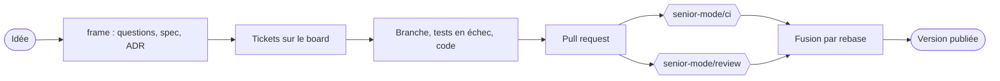

# senior-mode

[English](README.md) · **Français**

Un plugin Claude Code qui fait travailler le code assisté par IA comme une équipe d'ingénieurs
seniors. Les idées sont cadrées avant qu'on code. Les décisions sont écrites. Les tests passent en
premier et les commits restent petits. La feuille de route vit dans un GitHub Project. Chaque
changement est relu, et rien n'est fusionné sans contrôles au vert. Le processus suit la taille de
la tâche : une coquille n'a jamais droit à un ADR.

État : v0.1, jeune. Ce qui marche aujourd'hui et ce qui arrive est indiqué plus bas.

## Est-ce pour moi ?

- **Vous codez avec l'IA mais ça part dans tous les sens.** senior-mode pose les questions que vous
  oublieriez, écrit le plan et garde un historique propre : vous obtenez une application que vous
  pouvez montrer, transmettre ou faire auditer.
- **Vous êtes développeur.** Vous avez le TDD, des commits Conventional Commits atomiques, des
  specs et des ADR, un relecteur au contexte neuf et un modèle par type de tâche (haiku pour lire,
  sonnet pour construire, opus pour décider), sans cérémonie en plus pour les petites tâches.
- **Vous menez une petite équipe.** Le board, les statuts et les zones protégées rendent le travail
  d'un coéquipier IA visible et borné. Un humain valide ce qui touche la CI, la sécurité, les données
  ou l'architecture.

Ce n'est pas pour vous si vous cherchez un générateur de code en un coup, ou si votre projet ne vit
pas sur GitHub.

## Démarrer en 60 secondes

Dans Claude Code :

```
/plugin marketplace add Sycatle/senior-mode
/plugin install senior-mode@senior-mode
```

Puis, dans votre projet (un dépôt existant ou un dossier vide) :

```
/senior-mode:setup
```

Il montre ce qu'il va changer sur GitHub et attend votre oui. Il crée ensuite le board du Project,
les labels, les règles de fusion, les hooks git et la liste des contrôles. Relancez-le quand vous
voulez pour réparer. Ensuite :

```
/senior-mode:frame Je veux que les utilisateurs puissent exporter leurs factures en PDF
```

Il vous faut [`gh`](https://cli.github.com/) connecté (`gh auth refresh -s project` pour le board),
`git` et `jq`. La suite dans [Getting started](docs/guide/getting-started.md) (en anglais).

## Une journée type

1. **Cadrer.** `/senior-mode:frame` vous interroge quelques questions à la fois, propose des
   alternatives avec une recommandation, puis écrit la spec, les ADR et des tickets avec critères
   d'acceptation, taille, priorité et jalon.
2. **Construire.** Pour chaque ticket : une branche, les tests en échec d'abord, le code, de petits
   commits conventionnels. Les contrôles tournent avant chaque push et publient `senior-mode/ci`.
3. **Relire.** Un agent `reviewer` au contexte neuf relit la PR au regard de la spec et des règles
   d'ingénierie, puis pose `senior-mode/review`.
4. **Fusionner et publier.** Fusion par rebase quand les deux statuts sont au vert. Ce qui touche une
   zone protégée attend un humain. release-please tire des commits un changelog et une version.



Le déroulé pas à pas : [A typical day](docs/guide/a-typical-day.md) (en anglais).

## Commandes

| Commande | Ce qu'elle fait | État |
|---|---|---|
| `/senior-mode:setup` | Adopte un dépôt : board, labels, règles de fusion, ruleset, contrôles, hooks, modèles, release-please. Se relance sans risque. | Disponible |
| `/senior-mode:frame` | Transforme une idée en décisions, spec, ADR et tickets prêts. | Disponible |
| `/senior-mode:next` | La session du jour : état du board, pull requests qui vous attendent, puis livre avec vous le premier ticket prêt. Ne fusionne jamais sans votre accord. | Disponible |
| `/senior-mode:status` | Tableau de bord en clair : fait, en cours, bloqué, en attente de vous. Peut produire un résumé de la semaine pour un lecteur non technique. | Disponible |
| `/senior-mode:run` | Livre seule jusqu'à N tickets prêts, une session et un worktree par ticket, dans les garde-fous. S'arrête aux pull requests relues, sauf si vous activez la fusion. | Disponible |
| `/senior-mode:retro` | Chaque semaine : les faits de la semaine, puis jusqu'à trois changements de méthode à valider. | Disponible |

Derrière elles, de petits skills de discipline ne se chargent que quand ils s'appliquent (triage,
ready, tdd, commit, verify, spec, adr, grill, review, docs), et sept agents ont chacun leur modèle et leur
effort (scout, researcher, architect, test-author, implementer, reviewer, ops). Des hooks refusent
les force-push, les push sur la branche par défaut, les contrôles sautés et la lecture des fichiers
`.env` ou des clés, et tiennent les modifications de code hors d'un entretien de cadrage. Voir [Commands](docs/guide/commands.md),
[Skills](docs/guide/skills.md), [Agents](docs/guide/agents.md) et
[Autonomy and guardrails](docs/guide/autonomy.md) (en anglais).

## Pas de budget CI ? Aucun problème

Par défaut, les contrôles tournent sur votre machine avant chaque push et publient leur résultat en
statut de commit (`ci.mode: local`). GitHub refuse toujours une fusion sans lui. Si vous avez un
budget Actions, `ci.mode: actions` ajoute un workflow qui lance la même liste sur GitHub et publie
les versions. Voir [Configuration](docs/guide/configuration.md) (en anglais).

## Comparaison

Deux collections ont inspiré senior-mode, et elles sont excellentes. Prenez celle qui vous va.

| | senior-mode | [superpowers](https://github.com/obra/superpowers) | [mattpocock/skills](https://github.com/mattpocock/skills) |
|---|---|---|---|
| Axe | Livrer sur GitHub, de l'idée à la version publiée | La discipline de développement dans une session | L'alignement et la chaîne spec → tickets, petits skills combinables |
| Entretien de cadrage | Oui (`frame`, `grill`) | Oui (brainstorming) | Oui (`grill-me`, `grill-with-docs`) |
| TDD, relecture | Oui, la relecture pose un statut requis | Oui, relecture en deux temps | Oui |
| Issues et board | Issues et Projects GitHub (champs, jalons) | Non | Issues GitHub ou GitLab, sous-issues, dépendances |
| Règles de fusion et CI | Ruleset, statuts requis, CI locale ou Actions | Non | Non |
| Modèle par tâche | Fixé par agent | Par rôle, en consigne | Non |
| Plusieurs tickets en autonomie | Oui (`run`) | Un plan à la fois | Oui (`implement-spec`) |
| Plateformes | Claude Code | Claude Code et de nombreux autres agents | Claude Code et d'autres agents |

Prenez **superpowers** si vous voulez de bonnes habitudes à chaque session, sur de nombreux agents
de code, sans processus GitHub. Prenez **les skills de Matt Pocock** si vous voulez de petits skills
à adapter et avez déjà votre méthode. Prenez **senior-mode** si vous voulez tout le chemin, de la
première question au changement relu et publié, tenu par GitHub. Faits vérifiés en novembre 2026
sur les deux dépôts (superpowers v7.0.2, mattpocock/skills v1.3.2).

## Documentation

- [Guide utilisateur](docs/guide/README.md) (en anglais) : installation, journée type, commandes,
  skills, agents, garde-fous, configuration, FAQ.
- [Spec de conception](docs/specs/0001-senior-mode.md) et [décisions](docs/adr/).
- [Changelog](plugins/senior-mode/CHANGELOG.md) et la [feuille de route par jalon](https://github.com/Sycatle/senior-mode/milestones).

## Contribuer

Issues et pull requests sont bienvenues. Lisez d'abord [CONTRIBUTING.md](CONTRIBUTING.md) (en
anglais). Signalez les vulnérabilités en privé : voir [SECURITY.md](SECURITY.md).

## Licence

[MIT](LICENSE)
