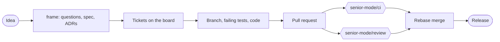

# senior-mode

**English** · [Français](README.fr.md)

A Claude Code plugin that makes AI-assisted coding work like a senior engineering team. Ideas get
framed before anyone codes. Decisions are written down. Tests come first and commits stay small.
The roadmap lives on a GitHub Project. Every change is reviewed, and nothing merges without passing
checks. The process scales with the task: a typo never gets an ADR.

Status: v0.2, young: the daily loop and the autonomous run work; security checks come in v0.3.
What works today and what is coming is marked below.

## Is it for me?

- **You build with AI but things get messy.** senior-mode asks the questions you would forget,
  writes the plan down and keeps a clean history, so you end up with an app you can show, hand over
  or audit.
- **You are a developer.** You get TDD, atomic Conventional Commits, specs and ADRs, a reviewer with
  a fresh context, and model routing per task (haiku to read, sonnet to build, opus to decide), with
  no extra ceremony for small tasks.
- **You run a small team.** The board, the statuses and the protected zones make an AI teammate's
  work visible and bounded. A human approves what touches CI, security, data or architecture.

It does not fit you if you want a one-shot code generator, or if your project does not live on
GitHub.

## Start in 60 seconds

In Claude Code:

```
/plugin marketplace add Sycatle/senior-mode
/plugin install senior-mode@senior-mode
```

Then, in your project (an existing repository or an empty folder):

```
/senior-mode:setup
```

It shows what it will change on GitHub and waits for your yes. Then it creates the Project board,
labels, merge rules, git hooks and the check list. Run it again at any time to repair. Then:

```
I want users to be able to export their invoices as PDF
```

A request in plain words is enough: Claude sizes it, frames it and starts. `/senior-mode:frame` is
the explicit form.

You need [`gh`](https://cli.github.com/) logged in (`gh auth refresh -s project` for the board),
`git` and `jq`. More in [Getting started](docs/guide/getting-started.md).

## A typical day

1. **Frame.** A plain request ("I want...") is sized, then Claude interviews you a few questions at
   a time and offers alternatives with a recommendation. A small change is delivered right away;
   a bigger one gets a spec, ADRs and tickets with acceptance criteria, size, priority and milestone.
2. **Build.** For each ticket: a branch, failing tests first, the code, small conventional commits.
   The checks run before each push and publish `senior-mode/ci`.
3. **Review.** A `reviewer` agent with a fresh context reviews the PR against the spec and against
   engineering standards, then sets `senior-mode/review`.
4. **Merge and release.** Rebase merge once both statuses are green. Changes to protected zones wait
   for a human. release-please turns the commits into a changelog and a version.



The walk-through, step by step: [A typical day](docs/guide/a-typical-day.md).

## Commands

| Command | What it does | State |
|---|---|---|
| `/senior-mode:frame` | Turn an idea into decisions, a spec, ADRs and ready tickets. | Available |
| `/senior-mode:go` | Moves the project forward: delivers the top ready ticket with you (never merges without your yes), or with `auto` starts the daemon that delivers on its own within the guardrails; when the daemon runs, shows what it does. | Available |
| `/senior-mode:status` | Plain-language dashboard: done, in progress, blocked, waiting for you. Also a digest for readers who are not technical, and the weekly retro when one is due. | Available |

Two more start on their own and stay callable: `/senior-mode:setup` adopts a repository (board,
labels, merge rules, ruleset, checks, hooks, templates; safe to rerun), and the first `go` runs it;
`/senior-mode:retro` gives the facts of the week and up to three process changes, and `status`
offers it once a week.

Behind them, small discipline skills load only when they apply (triage, ready, tdd, commit,
verify, spec, adr, grill, review, docs), and eight agents each have their own model and effort (scout,
researcher, architect, test-author, implementer, reviewer, security, ops). Hooks deny force-pushes, pushes
to the default branch, skipped checks and reading `.env` files or keys, and keep code edits out of a
framing interview. See
[Commands](docs/guide/commands.md), [Skills](docs/guide/skills.md), [Agents](docs/guide/agents.md)
and [Autonomy and guardrails](docs/guide/autonomy.md).

## No CI budget? No problem

By default the checks run on your machine before each push and publish their result as a commit
status (`ci.mode: local`). GitHub still refuses a merge without it. If you have an Actions budget,
`ci.mode: actions` adds a workflow that runs the same list on GitHub and releases. See
[Configuration](docs/guide/configuration.md).

## How it compares

Two collections inspired senior-mode, and they are excellent. Pick the one that fits.

| | senior-mode | [superpowers](https://github.com/obra/superpowers) | [mattpocock/skills](https://github.com/mattpocock/skills) |
|---|---|---|---|
| Focus | Delivery on GitHub, from idea to release | Development discipline inside a session | Alignment and spec-to-tickets, small composable skills |
| Framing interview | Yes (`frame`, `grill`) | Yes (brainstorming) | Yes (`grill-me`, `grill-with-docs`) |
| TDD, review | Yes, review sets a required status | Yes, two-stage review | Yes |
| Issues and board | GitHub Issues and Projects (fields, milestones) | No | GitHub or GitLab issues, sub-issues, dependencies |
| Merge rules and CI | Ruleset, required statuses, local or Actions CI | No | No |
| Model per task | Pinned per agent | Per role, by guidance | No |
| Autonomous multi-ticket run | Yes (`run`) | One plan at a time | Yes (`implement-spec`) |
| Platforms | Claude Code | Claude Code and many other agents | Claude Code and other agents |

Choose **superpowers** if you want strong habits in every session across many coding agents and do
not need GitHub process. Choose **Matt Pocock's skills** if you want small skills to adapt and
already have your own workflow. Choose **senior-mode** if you want the whole path, from the first
question to a reviewed, released change, enforced on GitHub. Facts checked in November 2026 against
both repositories (superpowers v7.0.2, mattpocock/skills v1.3.2).

## Documentation

- [User guide](docs/guide/README.md): install, a typical day, commands, skills, agents,
  guardrails, configuration, FAQ.
- [Products of several repositories and organizations](docs/guide/multi-repo.md).
- [Design spec](docs/specs/0001-senior-mode.md) and [decisions](docs/adr/).
- [Changelog](plugins/senior-mode/CHANGELOG.md) and the [roadmap by milestone](https://github.com/Sycatle/senior-mode/milestones).

## Contributing

Issues and pull requests are welcome. Read [CONTRIBUTING.md](CONTRIBUTING.md) first. Report
vulnerabilities privately: see [SECURITY.md](SECURITY.md).

## License

[MIT](LICENSE)
